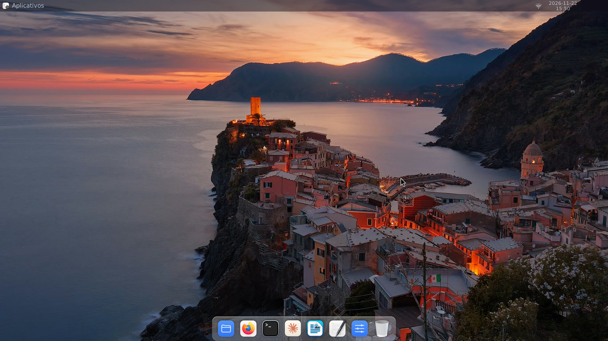
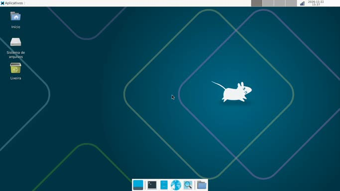
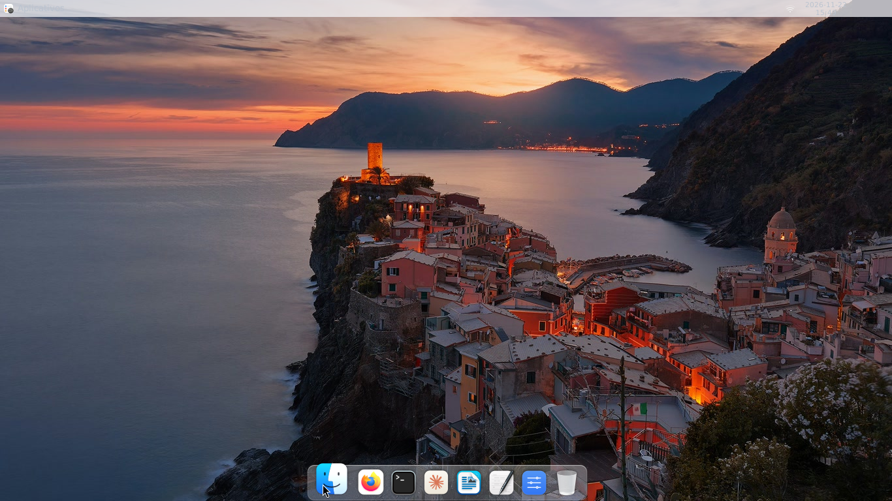
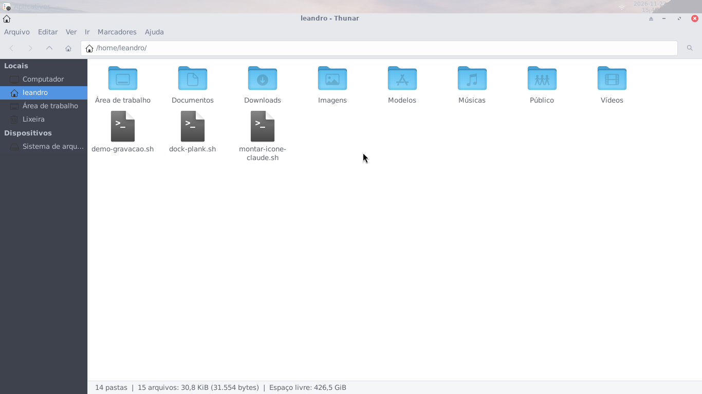
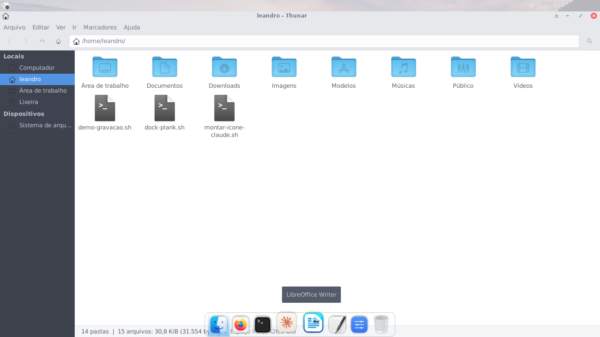
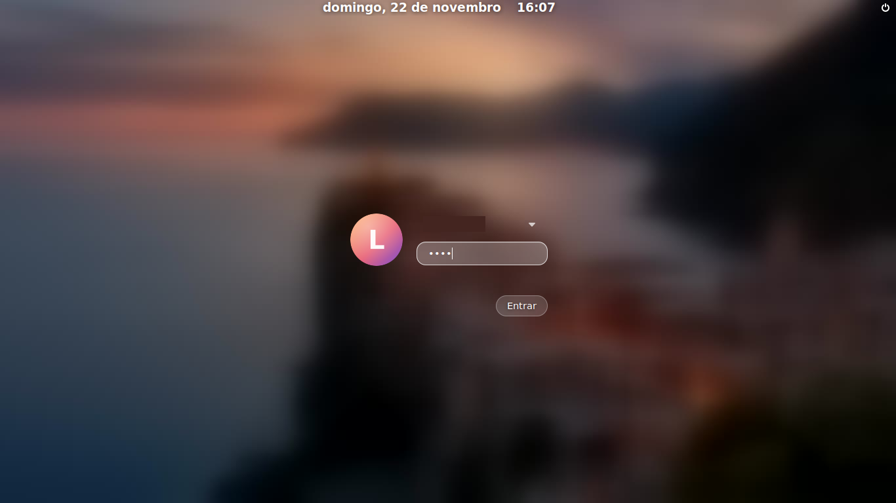
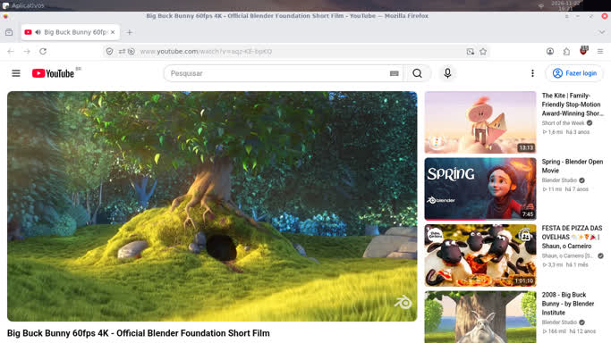

# Ressurreição de um notebook de 2016 — de Windows travado a Debian 13 em 45 segundos

> Estudo de caso técnico e documentado: um Positivo S14BW01 (Celeron N3010, **2 GB de RAM**, **HD de 5400 rpm**)
> que levava até 7 minutos para ligar e não abria o navegador foi diagnosticado **pela rede**, reinstalado com
> **Debian 13 + Xfce**, otimizado para pouca memória e customizado com visual inspirado no macOS —
> **sem trocar nenhuma peça**.



## Resultado em números

| Métrica | Windows 10 1803 (original) | Debian 13 recém-instalado | **Debian 13 otimizado** |
|---|---|---|---|
| Tempo até a tela de login | **131 s a 410 s** | 100,6 s | **44,7 s** |
| RAM ocupada parado | ~1,7 GB (0,2 GB livre) | 408 MB | **~400 MB** (login) / ~620 MB (área de trabalho) |
| Memória de troca | HD (lento) | HD | **zram** comprimida na RAM (+ HD de reserva) |
| Firefox (1ª abertura) | não abria | — | **5,0 s** |
| YouTube | inviável | — | toca, com **decodificação pela placa de vídeo** (VA‑API/H.264) |
| Suporte de segurança | encerrado | — | até **06/2030** (Debian 13 LTS) |

Tempos de abertura medidos com cronômetro automatizado (1ª abertura após ligar, gravando a tela ao mesmo tempo):
Arquivos 1,9 s · Terminal 2,1 s · Editor 2,3 s · Configurações 2,0 s · LibreOffice Writer 10,9 s.

## A história em 8 atos

1. **O pedido** — um seguidor viu o vídeo de outro PC "ressuscitado" e mandou o dele: não ligava; depois de ligar, levava minutos e os apps não abriam.
2. **Diagnóstico pela rede** — sem abrir o notebook: WinRM liberado por um script em pendrive, inventário completo coletado remotamente. Vilões: HD mecânico + 2 GB de RAM + Windows 10 de 2018. → [docs/01](docs/01-diagnostico.md)
3. **A decisão** — sem orçamento para SSD/RAM. Debian 13 mínimo + Xfce venceu Mint e MX por consumir menos RAM e ter suporte mais longo. → [plano/escolha-do-sistema.md](plano/escolha-do-sistema.md)
4. **Instalação** — ISO oficial com SHA512 conferido, copiada pela rede para o pendrive Ventoy, boot forçado remotamente. O Secure Boot barrou o Ventoy. → [docs/03](docs/03-instalacao-e-otimizacao.md)
5. **Otimização** — zram, earlyoom, serviços cortados, `noatime`, GRUB, initramfs enxuto: boot de 1min40 → 45 s, tudo via SSH e versionado em script.
6. **O falso travamento** — o notebook "congelou": na verdade a bateria acabou fora da tomada e o sistema hibernou. Diagnóstico pelo histórico do UPower. → [docs/04](docs/04-incidentes-e-licoes.md)
7. **Cara de Mac** — dock Plank com zoom e auto-ocultar, ícones WhiteSur, tela de bloqueio com fundo desfocado e avatar. Três versões do dock até chegar ao visual da referência. → [docs/05](docs/05-customizacao-visual.md)
8. **Prova final** — gravação automatizada (mouse com trajetória humana) de cada app abrindo pelo dock, YouTube tocando, efeito Matrix no terminal e Claude Code instalado. → [docs/06](docs/06-resultados-e-desempenho.md)

## Antes × depois

| Antes (Debian padrão, recém-instalado) | Depois (customizado) |
|---|---|
|  |  |

| Dock some com janela maximizada | …e volta ao encostar o mouse embaixo |
|---|---|
|  |  |

| Tela de login/bloqueio | YouTube com decodificação por hardware |
|---|---|
|  |  |

## Documentação

| Capítulo | Conteúdo |
|---|---|
| [01 — Diagnóstico](docs/01-diagnostico.md) | Inventário do hardware, estado do Windows, gargalos, medições de boot |
| [02 — Acesso remoto](docs/02-acesso-remoto.md) | WinRM no Windows, SSH com chave no Debian, armadilhas do PowerShell 5.1 |
| [03 — Instalação e otimização](docs/03-instalacao-e-otimizacao.md) | Mídia, boot remoto, instalação mínima, cada ajuste de desempenho e o porquê |
| [04 — Incidentes e lições](docs/04-incidentes-e-licoes.md) | Pós-mortems: Secure Boot, bateria, painel apagado, dock, uBlock, codificação |
| [05 — Customização visual](docs/05-customizacao-visual.md) | Papel de parede, ícones, dock (v1→v3), barra superior, tela de bloqueio, limites |
| [06 — Resultados e desempenho](docs/06-resultados-e-desempenho.md) | Tabelas comparativas, teste de YouTube, cronômetro de apps, vídeos |
| [07 — Guia para replicar](docs/07-guia-replicavel.md) | Passo a passo para aplicar o mesmo processo em outro PC antigo |
| [DIARIO.md](DIARIO.md) | Diário cronológico bruto de tudo o que foi feito (fonte primária) |

## Estrutura do repositório

```
├── README.md                 este arquivo
├── DIARIO.md                 diário técnico cronológico (cada entrada = commits)
├── docs/                     documentação por capítulo + docs/img (capturas)
├── plano/                    decisões: diagnóstico, escolha do SO, roteiro de instalação, dock
├── scripts/                  Windows (roda no notebook): inventário e liberação de acesso remoto
├── estacao/                  Windows (roda na estação): conexão WinRM e SSH
├── debian/                   Debian: medição, otimização, ajustes de sessão, dock, tela de bloqueio, demos
│   ├── visual/               papel de parede SVG, ícone do Claude Code, recortes
│   └── tela-bloqueio/        CSS do greeter, avatar, script de aplicação
├── relatorios/               saídas reais: inventário, medições antes/depois, logs de cada script
├── gravacoes/                vídeos antes/depois/apps + quadros extraídos
└── iso/SHA512SUMS            checksums oficiais da ISO usada
```

## Princípios do projeto

- **Medir antes de mexer**: toda otimização tem número antes e depois, inclusive quando o ganho não foi nosso (o AppArmor do 1º boot está explicado).
- **Tudo como código**: cada mudança no notebook é um script idempotente versionado, com log da execução em `relatorios/`.
- **Mínima intervenção física**: o que dava para fazer pela rede foi feito pela rede; o usuário só fez o que exige mão no equipamento.
- **Reversível**: backups dos arquivos de sistema alterados (`*.antes-pc-seguidor`) e caminhos de desfazer documentados.
- **Honestidade técnica**: limites assumidos (sem Liquid Glass, sem tela de bloqueio em dois estados) e erros próprios registrados como pós-mortem.

## Privacidade

Este repositório é público. Números de série, endereços MAC completos, IP público, nome/usuário do dono do notebook e dados da estação de trabalho do autor foram **removidos de todo o histórico do Git** (não só da versão atual) e substituídos por marcadores (`[serial-removido]`, `XX`, `usuario`). Nenhuma senha, chave privada ou credencial faz parte do repositório: as credenciais ficaram apenas na estação de trabalho, fora da pasta do projeto, e as chaves de acesso temporário estão listadas para remoção.

## Créditos e licenças de terceiros

- Foto de fundo: *Vernazza*, de Anders Jildén — [Unsplash](https://unsplash.com) (Licença Unsplash).
- Ícones **WhiteSur** — [vinceliuice/WhiteSur-icon-theme](https://github.com/vinceliuice/WhiteSur-icon-theme) (GPL‑3.0), instalados no notebook; não redistribuídos aqui.
- Símbolo do Claude usado no atalho do Claude Code — marca da Anthropic, obtido do Wikimedia Commons; uso apenas para identificar o aplicativo oficial.
- Debian, Xfce, Plank, Arc, elementary‑xfce, zram‑tools, earlyoom, Firefox ESR, LibreOffice: projetos livres dos seus respectivos autores.
- Papel de parede "Entardecer" (`debian/visual/papel-de-parede.svg`) e ícones próprios: criados neste projeto.
