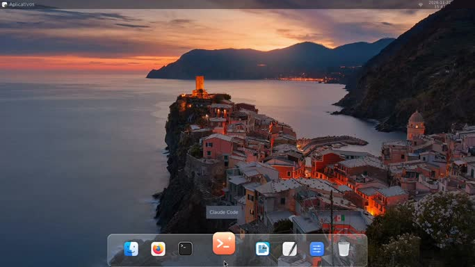
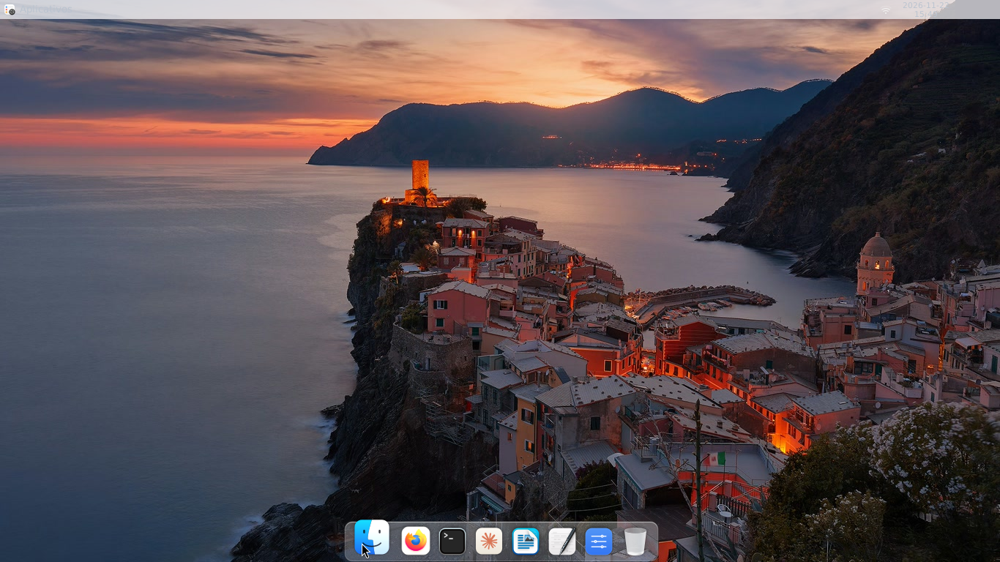
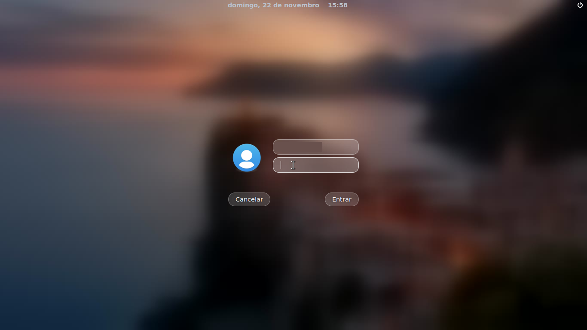
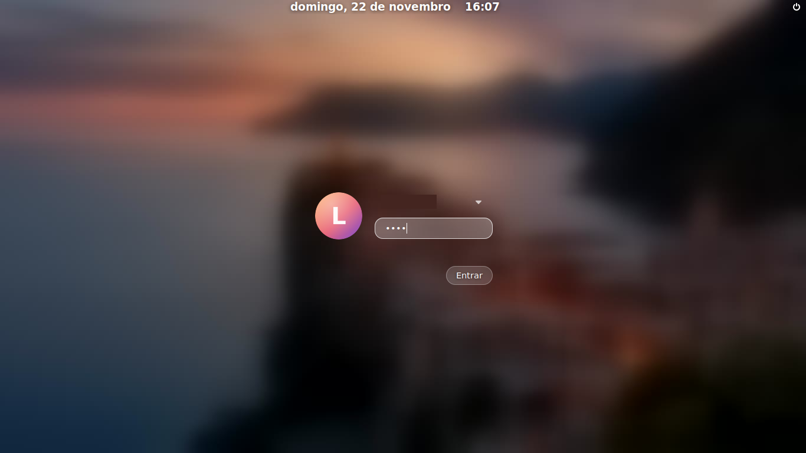

# 05 — Customização visual (inspirada no macOS)

Restrição: **não pesar**. Medido: ~556 MB → ~620–690 MB com a área de trabalho (o Plank ocupa ~40 MB).

## Papel de parede
- Proposta inicial: **"Entardecer"**, um SVG original de ondas em degradê ([`debian/visual/papel-de-parede.svg`](../debian/visual/papel-de-parede.svg)), renderizado com `rsvg-convert` → [prévia](img/12-papel-de-parede-entardecer.png).
- Versão final: foto escolhida pelo autor (Vernazza, Unsplash), recortada de 3:2 para 1366×768 com `ffmpeg scale+crop`.

## Ícones e tema
- **WhiteSur** (GitHub, commit `73d8040`): instalador revisado antes, rodado sem root, em `~/.local/share/icons` (102 MB de disco, nenhum custo de RAM).
  O primeiro bloqueio de segurança da automação levou a um plano B com o **elementary‑xfce** (repo Debian), trocado depois de autorização explícita.
- Janelas e GTK: **Arc** (repo Debian).

## Dock — [`debian/dock-plank.sh`](../debian/dock-plank.sh)
Plank 0.11.89 com o tema próprio **"Vidro"**:

| Parâmetro | v1 (rejeitada) | v3 (final) |
|---|---|---|
| Tamanho do ícone | 46 | **42** |
| Zoom | 165% | **128%** |
| Paddings (H/topo/base/item) | 6/4/6/7 | **1,2/1,4/1,4/2** |
| Fundo | branco 27% | branco 31→23% + borda escura sutil (alfa 55) + reflexo interno |
| Ocultar | window-dodge | window-dodge: some com janela encostando, volta com o mouse na borda |

Itens: Arquivos, Firefox, Terminal, **Claude Code**, Writer, Editor, Configurações, Lixeira.
O atalho do Claude Code abre `xfce4-terminal -x bash -lc "claude; exec bash"`, com ícone montado a partir do **símbolo oficial do Claude** ([`montar-icone-claude.sh`](../debian/visual/montar-icone-claude.sh)).

| v1 — grande e espalhada | v3 — compacta |
|---|---|
|  |  |

### Barra superior
Escura translúcida (`rgba 0.06,0.06,0.09,0.45`), só com menu, bandeja, relógio e ações. Saíram a lista de janelas e as áreas de trabalho. O painel inferior foi removido.

## Tela de bloqueio/login — [`debian/tela-bloqueio/`](../debian/tela-bloqueio/)
O light-locker usa o **LightDM GTK greeter 2.0.9**, que é a mesma tela do login.

| Elemento | Implementação |
|---|---|
| Fundo desfocado | `ffmpeg gblur=sigma=28` gerado **uma vez** (custo zero ao bloquear) |
| Avatar redondo | SVG próprio (degradê + inicial) → AccountsService; `round-user-image=true` |
| Vidro, sem caixas | CSS em `/var/lib/lightdm/.config/gtk-3.0/gtk.css` (o greeter roda como `lightdm`) |
| Data e hora | `clock-format=%A, %d de %B    %H:%M`, branco 14 pt (o item do relógio é "disabled"; o CSS força a cor) |
| Nome do usuário | `greeter-hide-users=false` em `lightdm.conf.d` |

| v1 (sem avatar, relógio cinza) | final |
|---|---|
|  |  |

### Limites assumidos
- **Liquid Glass / efeito de lente:** nenhum dock X11 faz isso. Seria preciso um shader próprio no compositor. Fora de escopo.
- **Vidro fosco real (blur ao vivo):** exigiria o picom com `dual_kawase` refazendo o desfoque a cada quadro. Não compensa nesta GPU.
- **Bloqueio em dois estados** (foto nítida + relógio → clique → desfoque) e **player de música** no bloqueio: o greeter GTK tem um estado só. Greeters HTML (web-greeter/nody-greeter) sobem um navegador inteiro a cada bloqueio, o que é pesado para 2 GB e fica na tela que protege a senha.
- **Avatar acima do campo de senha:** o layout do greeter GTK é fixo (lado a lado).
